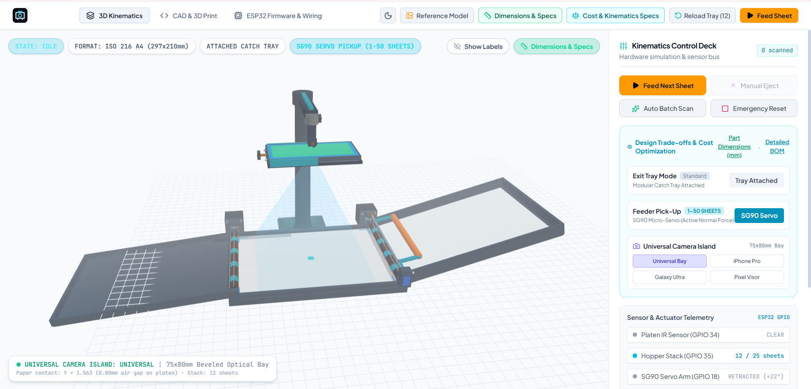
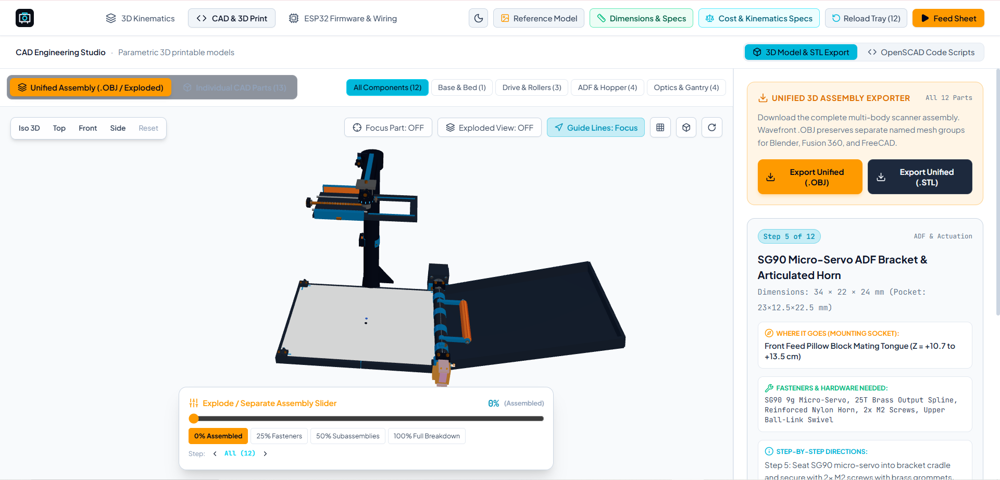

# ScannerTwin 3D

ScannerTwin 3D is a browser-based simulation and engineering workspace for a low-cost, DIY automated document scanner that uses a smartphone as its camera.

## Why this project

The original idea was a collaboration: I would design the IoT side of the scanner, including its controller and firmware, while my friend would build a mobile app that could run on different phones and control the scanner. My work on IoT projects had shown me how useful it is to simulate firmware, circuits, and mechanisms before assembling hardware. We did not have one web-based place to see how the scanner's mechanics and control flow could work together, so I built this project to make that system easier to visualize and explore.

The browser app brings together a 3D mechanical model, scanner-state and sensor simulations, CAD resources, and firmware and wiring references. It helps communicate the design and explore proposed behavior before building the physical scanner and companion app.

**Scope:** This is a frontend prototype. Its scanner controls and telemetry are simulated; it does not currently connect to a physical ESP32, capture documents, simulate circuit behavior, or provide the planned cross-platform mobile app. Firmware, wiring, and Python client content are references for the hardware/software design.

## Screenshots

### 3D Kinematics Dashboard



### CAD & 3D Print Studio



## Features

- **Digital twin:** Explore the scanner assembly, run simulated feed/eject cycles, adjust configuration options, and inspect simulated sensor and scanner states.
- **CAD & 3D printing:** View the complete assembly or individual parts, inspect exploded configurations, export 3D files, and browse OpenSCAD source.
- **Firmware & wiring references:** Review and download example ESP32 C++ firmware and a Python test client, and inspect the wiring and power-distribution guide.
- **Engineering tools:** Inspect part dimensions and hardware information, compare design trade-offs, and switch between light and dark themes.

## Technical overview

- **UI:** React single-page application built and served by Vite.
- **Simulation state:** Redux Toolkit manages scanner state, simulated telemetry, configuration, and UI selections.
- **3D visualization:** Three.js renders the scanner assembly, components, and simulated motion in the browser.
- **CAD resources:** Model data and export utilities support assembly/part viewing and file downloads; OpenSCAD source is available in the CAD studio.
- **Firmware materials:** Firmware, wiring guidance, and the Python test client are presented as reference content in the app. They are not executed by the browser simulation.
- **Deployment:** Vite produces a static site in `dist/`. No backend service or environment variables are needed for the current prototype.

## Requirements

- Node.js 20.19 or newer
- npm

## Run locally

```sh
npm ci
npm run dev
```

Open the local URL printed by Vite (by default, `http://localhost:3000`).

## Build and preview

Create an optimized production build:

```sh
npm run build
```

Vite writes the static site to `dist/`. To serve that build locally:

```sh
npm run preview
```

## Deploy

Deploy the contents of `dist/` to any static hosting provider, such as Cloudflare Pages, Netlify, or Vercel. Configure the provider to run `npm run build` and use `dist` as the output directory. The current prototype is a static frontend and does not require server-side APIs, secrets, or environment variables.

## Technology

- React
- Vite
- Redux Toolkit
- Three.js
- Tailwind CSS
